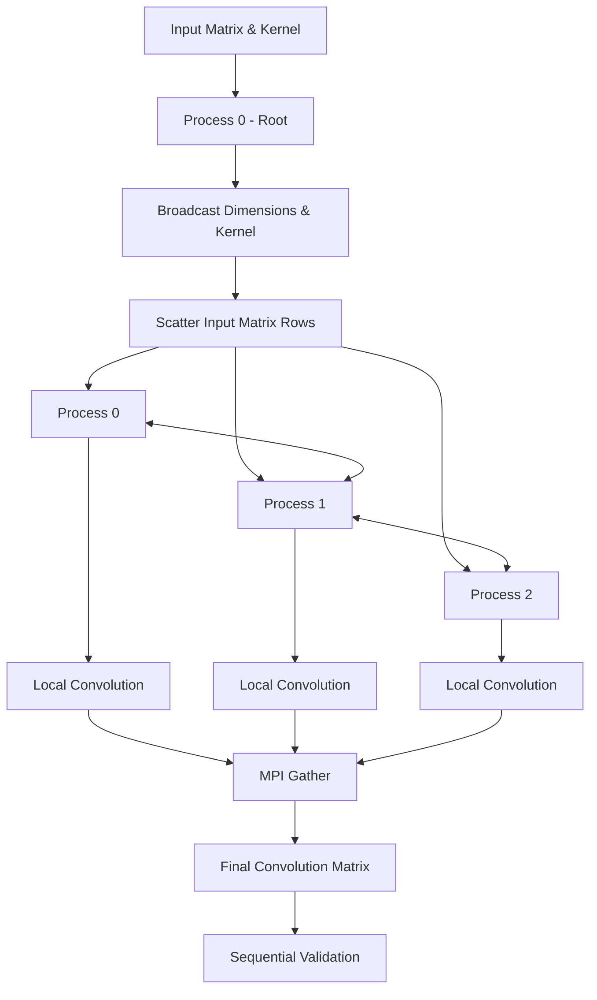

# ECE 662 | Parallel Matrix Convolution using MPI

<p align="center">
  <strong>Distributed Computing · Parallel Processing · Python</strong>
</p>

<p align="center">
  
  
  
  
  
</p>

---

## 01 | Project Overview

This project implements **parallel 2D matrix convolution using the Message Passing Interface (MPI)** in Python.

The objective is to distribute convolution computations across multiple processes, enabling independent computation on different portions of an input matrix while maintaining correct boundary handling.

The implementation uses three MPI processes and demonstrates distributed data management, inter-process communication, and result aggregation.

### Key Highlights

| Component | Implementation |
|---|---|
| Parallel framework | MPI |
| Programming language | Python |
| Input distribution | MPI Scatter |
| Kernel distribution | MPI Broadcast |
| Boundary exchange | MPI Send / Receive |
| Result aggregation | MPI Gather |
| Verification | Sequential vs. parallel comparison |
| Number of processes | 3 |

---

## 02 | System Architecture

The input matrix is partitioned row-wise across three processes. Each process performs convolution on its assigned portion and exchanges boundary rows with neighboring processes.



### Process Distribution

For a 6 × 4 input matrix:

| MPI Process | Assigned Rows | Workload |
|---|---|---|
| Rank 0 | 0–1 | Local convolution |
| Rank 1 | 2–3 | Local convolution |
| Rank 2 | 4–5 | Local convolution |

Each process receives two rows of the original matrix.

---

## 03 | Modular Implementation

The implementation is organized into the following functional modules.

### Module 1 — MPI Initialization

Establishes the global communicator and retrieves process information.

```python
comm = MPI.COMM_WORLD

size = comm.Get_size()
rank = comm.Get_rank()
```

**Purpose:** Identify individual processes and coordinate distributed execution.

### Module 2 — Input Initialization

Process 0 initializes the input matrix and convolution kernel.

**Input Matrix**

```python
img = np.array([
    [3, 9, 5, 9],
    [1, 7, 4, 3],
    [2, 1, 6, 5],
    [3, 9, 5, 9],
    [1, 7, 4, 3],
    [2, 1, 6, 5]
])
```

**Convolution Kernel**

```python
kernel = np.array([
    [ 0,  1, 0],
    [ 0,  0, 0],
    [ 0, -1, 0]
])
```

### Module 3 — Dimension and Kernel Broadcasting

MPI `Bcast()` distributes matrix dimensions and kernel information from the root process to all participating processes.

```python
comm.Bcast(dims, root=0)
comm.Bcast(kernel, root=0)
```

**Purpose:** Ensure every process has the information required for local computation.

### Module 4 — Matrix Distribution

MPI `Scatter()` distributes equal portions of the input matrix.

```python
rows_per_process = DIMx // size

recvbuf = np.empty(
    (rows_per_process, DIMy),
    dtype=np.int64
)

comm.Scatter(sendbuf, recvbuf, root=0)
```

**Purpose:** Divide the input workload across three processes.

### Module 5 — Boundary Exchange

Neighboring processes exchange boundary rows using point-to-point communication.

```python
comm.Send(...)
comm.Recv(...)
```

The exchanged rows provide the neighboring data required for convolution at process boundaries.

Zero padding is applied at the outer boundaries of the original matrix.

**Purpose:** Maintain correct convolution results across partition boundaries.

### Module 6 — Local Convolution

Each process executes `convolve_func()` using its local matrix rows, kernel, and exchanged boundary rows.

```python
local_conv = convolve_func(
    recvbuf.flatten(),
    kernel,
    KERNEL_DIM,
    rows_per_process,
    DIMy,
    upper_pad,
    lower_pad
)
```

**Purpose:** Perform independent convolution computations on each process.

### Module 7 — Result Aggregation

MPI `Gather()` collects the local convolution results at Process 0.

```python
comm.Gather(local_conv, gathered, root=0)
```

The resulting flattened array is reshaped into the original matrix dimensions.

### Module 8 — Sequential Validation

The sequential implementation is executed on Process 0 and compared against the parallel result.

```python
np.array_equal(conv1, recvbuf)
```

**Purpose:** Verify computational correctness.

---

## 04 | MPI Communication Summary

| MPI Operation | Function | Responsibility |
|---|---|---|
| `Bcast()` | Broadcast | Distribute dimensions and kernel |
| `Scatter()` | Scatter | Distribute input matrix rows |
| `Send()` | Point-to-point | Send boundary rows |
| `Recv()` | Point-to-point | Receive boundary rows |
| `Gather()` | Gather | Collect convolution outputs |

---

## 05 | Experimental Results

**Test Configuration**

| Parameter | Value |
|---|---:|
| Input dimensions | 6 × 4 |
| Kernel dimensions | 3 × 3 |
| MPI processes | 3 |
| Rows per process | 2 |
| Output dimensions | 6 × 4 |

### Sequential Output

```text
[[-1 -7 -4 -3]
 [ 1  8 -1  4]
 [-2 -2 -1 -6]
 [ 1 -6  2  2]
 [ 1  8 -1  4]
 [ 1  7  4  3]]
```

### Parallel Output

```text
[[-1 -7 -4 -3]
 [ 1  8 -1  4]
 [-2 -2 -1 -6]
 [ 1 -6  2  2]
 [ 1  8 -1  4]
 [ 1  7  4  3]]
```

### Validation

<p align="center">
  
</p>

```text
Outputs match: True
```

The sequential and parallel implementations produce identical results for the supplied test case.

---

## 06 | Installation & Execution

### Prerequisites

- Anaconda
- Python 3
- Jupyter Notebook
- IPython
- mpi4py
- ipyparallel
- NumPy
- Compatible MPI runtime

### Step 1 — Create Environment

```bash
conda create --name myenv
conda activate myenv
```

### Step 2 — Install Dependencies

```bash
conda install -c anaconda ipython
conda install -c conda-forge jupyterlab
conda install -c conda-forge mpi4py
conda install -c anaconda ipyparallel
conda install numpy
```

### Step 3 — Start MPI Cluster

**Ubuntu / macOS**

```bash
ipcluster start -n 3 --engines=MPIEngineSetLauncher & jupyter notebook
```

**Windows (Anaconda Prompt)**

```bash
start /b ipcluster start -n 3 --engines=MPIEngineSetLauncher --cluster-id='mpi'
```

Wait until the engines report:

```text
Engines appear to have started successfully
```

Then launch Jupyter Notebook:

```bash
jupyter notebook
```

### Step 4 — Connect to IPython Cluster

For Ubuntu / macOS:

```python
from ipyparallel import Client

clients = Client()
clients.block = True

print(clients.ids)
```

For Windows:

```python
from ipyparallel import Client

clients = Client(cluster_id='mpi')
clients.block = True

print(clients.ids)
```

Expected output:

```text
[0, 1, 2]
```

### Step 5 — Run Notebook

Open `Conv_MPI.ipynb` and execute the notebook cells in order.

**Note:** Google Colab is not supported by the supplied lab environment instructions.

---

## 07 | Repository Structure

```text
ECE662-MPI-Convolution/
│
├── README.md
│
├── Conv_MPI.ipynb
│
└── Conv_MPI_Starter.ipynb
```

The starter notebook is optional and should only be included if uploaded.

---

## 08 | Key Learnings

- Distributed computing using MPI.
- Process management through communicators and ranks.
- Collective communication and data distribution.
- Point-to-point communication between neighboring processes.
- Parallel matrix computation.
- Boundary handling in distributed convolution.
- Validation of parallel algorithms against sequential implementations.

---

## 09 | Scope & Limitations

- The current implementation uses three MPI processes.
- Equal row partitioning is assumed.
- Input rows must be divisible by the number of processes.
- The supplied convolution function assumes a square, odd-sized kernel.
- Performance benchmarking and speedup measurements are outside the current validation.

---

<p align="center">
  <strong>ECE 562/662 — Hardware for Machine Learning</strong>
  <br/>
  Lab 2 | Parallelization Using MPI
  <br/><br/>
  <sub>Distributed Computing · Parallel Algorithms · Matrix Convolution</sub>
</p>

